# Heart Disease Prediction + Explainable AI (SHAP)


Prédiction du risque de maladie cardiaque à partir de 13 variables cliniques, avec **explication de chaque prédiction par SHAP**, une évaluation par **validation croisée imbriquée** et une **analyse des erreurs**.

> **Avertissement** : exercice académique de machine learning et d'explicabilité. Ce n'est pas un outil de diagnostic médical et il ne doit pas servir à une décision clinique.

## Résultats en bref

| | Régression logistique (modèle retenu) |
|---|---|
| Accuracy | 83.2 ± 6.2 % |
| Precision | 83.7 ± 5.0 % |
| Recall (sensibilité) | 78.2 ± 13.7 % |
| Spécificité | 87.3 ± 4.0 % |
| F1-score | 80.4 ± 8.3 % |
| ROC-AUC | 0.906 ± 0.060 |
| PR-AUC | 0.900 ± 0.050 |

Validation croisée stratifiée imbriquée (5 plis), 303 patients, moyenne ± écart-type entre plis. **Les trois modèles testés ne se distinguent pas statistiquement** (voir ci-dessous) : on retient le plus simple.

## Le dataset et un piège à connaître

**UCI Heart Disease (Cleveland)** : 303 patients, 13 variables cliniques (âge, sexe, type de douleur thoracique, tension, cholestérol, fréquence cardiaque max, ST depression, vaisseaux colorés, thalassémie, etc.), aucune valeur manquante.

**Dans ce fichier `heart.csv` (version Kaggle), la colonne `target` est inversée : `target = 1` correspond à l'absence de maladie** (165 patients) et `target = 0` à sa présence (138). On le voit sur les données : les patients `target = 0` ont bien plus souvent une angine d'effort, des vaisseaux atteints, un sous-décalage ST marqué et une fréquence cardiaque max plus basse.

| Groupe | % avec `target = 1` |
|---|---|
| Angine d'effort : non / oui | 70 % / 23 % |
| Vaisseaux colorés : 0 / ≥ 1 | 74 % / 27 % |
| Sexe : femmes / hommes | 75 % / 45 % |

Le projet définit donc `disease = 1 - target` à un seul endroit (`src/preprocessing.py::disease_label`) et un test automatique (`test_disease_label_is_medically_consistent`) empêche toute régression. Sans cette correction, les explications SHAP seraient médicalement à l'envers (par exemple « l'absence d'angine d'effort augmente le risque »).

Autres anomalies du CSV : 5 lignes avec `ca = 4` et 2 avec `thal = 0`, valeurs hors documentation. Elles sont conservées pour l'entraînement ; l'API les refuse en entrée.

## Preprocessing sans fuite de données

| Variables | Nature | Traitement | Pourquoi |
|---|---|---|---|
| `age`, `trestbps`, `chol`, `thalach`, `oldpeak` | numériques continues | standardisées | mmHg, mg/dl et bpm n'ont pas la même échelle : sans standardisation, les coefficients d'une régression logistique régularisée ne sont pas comparables |
| `ca` (vaisseaux colorés, 0 à 3) | comptage ordonné | numérique, standardisée | un seul coefficient lisible (« par vaisseau en plus ») au lieu de cinq ; le one-hot n'apporte rien de mesurable (voir ci-dessous) |
| `cp`, `restecg`, `slope`, `thal` | catégorielles nominales | **one-hot**, non standardisées | les codes 0/1/2/3 sont des étiquettes, pas des quantités : `thal = 3` n'est pas « trois fois » `thal = 1` |
| `sex`, `fbs`, `exang` | binaires | laissées en 0/1 | déjà interprétables |

**Ce qui empêche la fuite de données** (chaque point est vérifié par `tests/test_leakage.py`) :

- split train/test **stratifié, `random_state = 42`**, jeux disjoints, 61 patients de test ;
- le `StandardScaler` est **ajusté sur le train uniquement**, puis appliqué au test ; en validation croisée il est dans un `Pipeline` sklearn, donc ré-ajusté dans chaque pli d'entraînement ;
- déformer le test set (valeurs × 100) ne change ni le scaler ni le train : le test n'influence rien ;
- le one-hot (`pd.get_dummies`) est fait avant le split, mais il ne fait que fixer la liste des colonnes, sans rien apprendre des données ;
- la cible n'est jamais parmi les variables d'entrée.

Ces tests ont un vrai pouvoir de détection : en introduisant volontairement le bug (scaler ajusté sur toutes les données), deux d'entre eux échouent.

### Les choix d'encodage ont été testés, pas seulement affirmés

`python src/encoding_ablation.py` compare des variantes sur les **mêmes plis** (5 plis × 10 répétitions, régression logistique, scaler et encodeurs appris dans chaque pli) :

| Variante | ROC-AUC | F1 | Δ ROC-AUC vs retenue (appariée) | plis où elle gagne |
|---|---|---|---|---|
| **Retenue** : one-hot (cp, restecg, slope, thal) + `ca` numérique | 0.907 ± 0.036 | 0.797 ± 0.064 | référence | — |
| `ca` aussi en one-hot | 0.912 ± 0.035 | 0.805 ± 0.063 | +0.0044 ± 0.0088 | 64 % |
| `slope` en ordinal numérique | 0.904 ± 0.037 | 0.790 ± 0.068 | −0.0033 ± 0.0056 | 28 % |
| cp/restecg/slope/thal en codes 0-3 (nominal traité comme ordonné) | 0.897 ± 0.039 | 0.796 ± 0.059 | −0.0101 ± 0.0187 | 24 % |
| `ca = 4` et `thal = 0` traités comme manquants, imputés dans le pli | 0.915 ± 0.035 | 0.812 ± 0.059 | +0.0075 ± 0.0080 | 82 % |

- **`ca` en one-hot** : écart plus petit que sa propre variabilité, on garde la version numérique, plus simple.
- **Nominales traitées comme ordonnées** : légèrement moins bon (−0.010, perdant dans 76 % des plis), ce qui confirme le one-hot.
- **Contrôle d'équivalence** : un `OneHotEncoder` appris dans chaque pli donne les mêmes prédictions que le `get_dummies` du projet (écart maximal 4·10⁻¹⁶). Faire le one-hot avant le split ne crée donc aucune fuite.
- **Valeurs hors documentation** : seule piste qui sort un peu du bruit. Traiter les 7 lignes concernées (`ca = 4`, `thal = 0`) comme des valeurs manquantes imputées dans le pli gagne environ un écart-type apparié. Elle n'est pas adoptée ici : le gain est faible pour 2,3 % des lignes, et l'adopter changerait le modèle déployé et tous les chiffres de ce README. C'est la première amélioration à tester ensuite.

Les plis se recouvrent : ces écarts sont descriptifs, pas un test statistique. Cette ablation sert à comparer des encodages ; les performances de référence restent celles de la validation croisée imbriquée ci-dessous.

## Méthodologie d'évaluation

Sur un jeu de 303 patients, un seul split train/test (61 patients de test) est très bruité : un patient mal classé change l'accuracy de 1,6 point. L'évaluation repose donc sur une **validation croisée imbriquée** (`src/evaluate.py`) :

- **boucle externe** : `StratifiedKFold` à 5 plis, qui estime la performance
- **boucle interne** : validation croisée à 3 plis qui règle les hyperparamètres **uniquement sur le pli d'entraînement** (`GridSearchCV` pour la régression logistique, `RandomizedSearchCV` à 12 combinaisons pour Random Forest et XGBoost), donc l'estimation n'est pas optimiste
- standardisation réajustée dans chaque pli via un `Pipeline` (aucune fuite d'information)
- 3 modèles : régression logistique (baseline), Random Forest, XGBoost
- chaque patient est prédit une fois par un modèle qui ne l'a jamais vu (prédictions *out-of-fold*), ce qui sert aussi à l'analyse des erreurs

| Modèle | Accuracy | Precision | Recall (Sensitivity) | Specificity | F1-score | ROC-AUC | PR-AUC |
|---|---|---|---|---|---|---|---|
| Logistic Regression ✅ | 0.832 ± 0.062 | 0.837 ± 0.050 | 0.782 ± 0.137 | 0.873 ± 0.040 | 0.804 ± 0.083 | 0.906 ± 0.060 | 0.900 ± 0.050 |
| Random Forest | 0.848 ± 0.061 | 0.858 ± 0.047 | 0.797 ± 0.117 | 0.891 ± 0.035 | 0.824 ± 0.081 | 0.912 ± 0.054 | 0.904 ± 0.050 |
| XGBoost | 0.815 ± 0.059 | 0.818 ± 0.046 | 0.761 ± 0.110 | 0.861 ± 0.035 | 0.786 ± 0.077 | 0.900 ± 0.046 | 0.900 ± 0.038 |

Le Random Forest a les moyennes les plus hautes, mais les écarts entre modèles (≈ 0,01 à 0,04) sont du même ordre que les écarts-types entre plis (0,04 à 0,14) : avec 303 patients, désigner un « gagnant » reviendrait à suivre du bruit. La **règle de l'erreur standard** retient le modèle le plus simple dont le F1 est à moins d'une erreur standard du meilleur (SE = 0,036) : la régression logistique, qui est aussi exactement explicable.

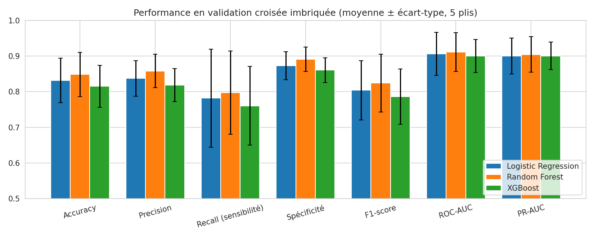

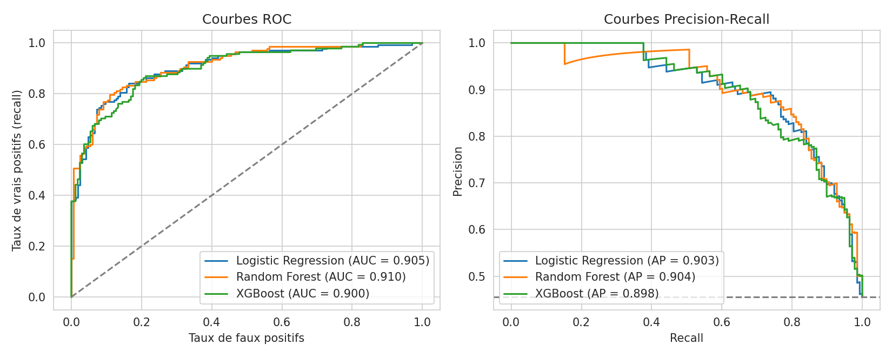

### Matrice de confusion (prédictions out-of-fold, 303 patients)

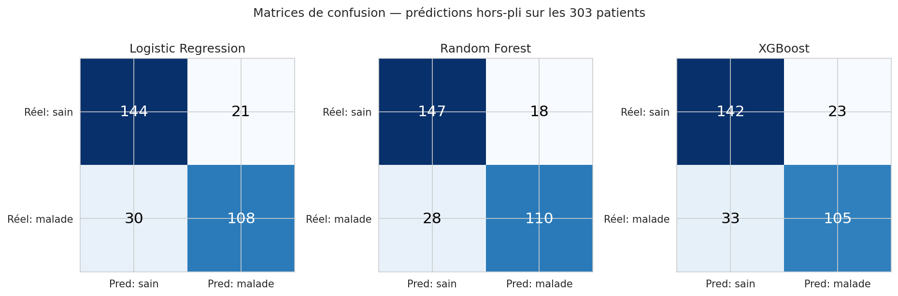

Pour le modèle retenu : 108 vrais positifs, 144 vrais négatifs, 21 faux positifs, 30 faux négatifs. **30 des 138 malades (environ 1 sur 5) ne sont pas détectés** : c'est la limite principale du modèle si on imaginait un usage de dépistage.

## Analyse des erreurs

Profil moyen de chaque groupe (prédictions out-of-fold, modèle retenu) :

| Groupe | n | Âge | FC max | ST depr. | % angine d'effort | % ≥ 1 vaisseau |
|---|---|---|---|---|---|---|
| Vrais positifs | 108 | 57,3 | 134,6 | 1,8 | 67 % | 76 % |
| **Faux négatifs** (malades prédits sains) | 30 | 54,0 | 155,2 | 0,6 | 13 % | 37 % |
| Vrais négatifs | 144 | 51,5 | 160,8 | 0,5 | 11 % | 19 % |
| **Faux positifs** (sains prédits malades) | 21 | 59,5 | 142,2 | 1,1 | 33 % | 33 % |

- **Les faux négatifs ressemblent à des patients sains** : peu de dépression ST, rarement une angine d'effort, fréquence cardiaque max élevée, moins de vaisseaux atteints que chez les vrais positifs. Le modèle n'a presque aucun signal à exploiter chez eux.
- **Les faux positifs ressemblent à des patients malades** : plus âgés, quasi tous des hommes (90 %), une thalassémie avec défaut réversible dans 62 % des cas (contre 10 % chez les vrais négatifs) et une fréquence cardiaque max plus basse.

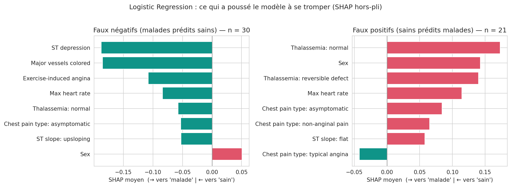

**Comment lire ce graphique.** Chaque barre est la contribution SHAP moyenne d'une variable chez les patients mal classés (rouge : vers « malade », vert : vers « sain »). Elle dit ce qui a poussé le modèle à se tromper, pas pourquoi le patient est réellement malade ou sain. Chez les faux négatifs, la ST depression, les vaisseaux colorés, l'angine d'effort et la fréquence cardiaque max poussent vers « sain ». Chez les faux positifs, la thalassémie non normale, le sexe masculin et la fréquence cardiaque basse poussent vers « malade ».

Explications individuelles du faux négatif et du faux positif les plus tranchés :

| Faux négatif | Faux positif |
|---|---|
| 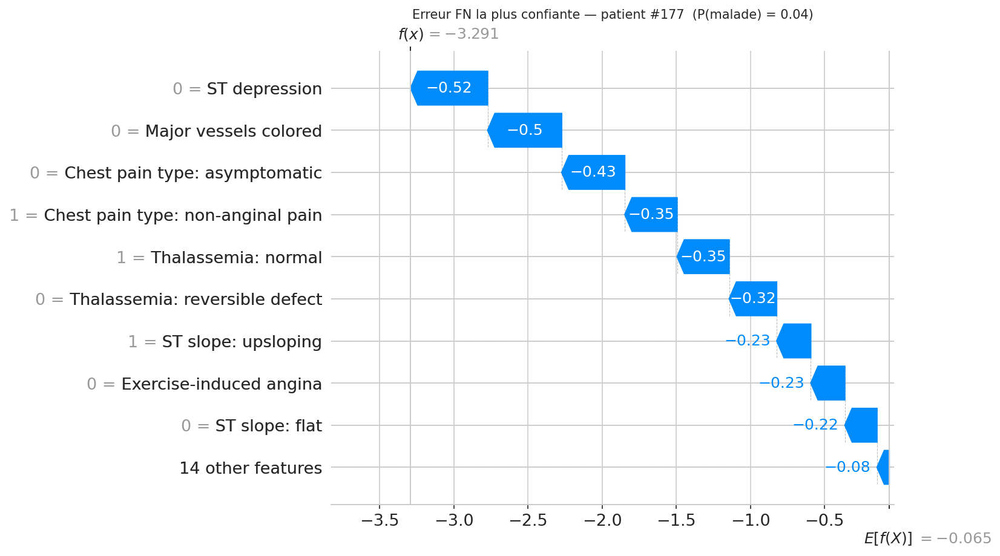 | 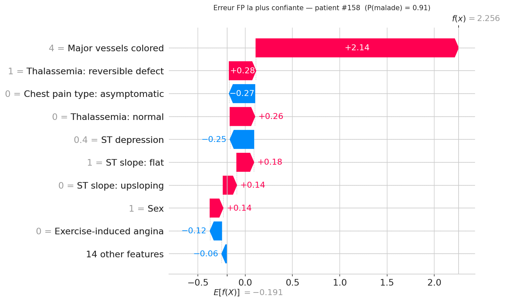 |

La liste complète des 51 patients mal classés, avec leurs 3 facteurs SHAP principaux, est dans `reports/misclassified_patients.csv`. Le détail chiffré (écarts standardisés, 5 erreurs les plus confiantes de chaque type) est dans `reports/error_analysis.md`.

## SHAP : comprendre pourquoi le modèle prédit ce qu'il prédit

> **SHAP explique le comportement du modèle, pas une relation causale médicale.** Une variable qui « augmente la probabilité estimée » n'est pas pour autant une cause de la maladie. **Projet académique : ce n'est pas un outil de diagnostic médical.**

SHAP répartit l'écart entre la prédiction faite pour un patient et celle d'un « patient moyen » du jeu d'entraînement entre les variables. Les contributions sont **additives** : valeur de base + somme des contributions = sortie du modèle (testé à 10⁻⁹ près dans `tests/test_shap_utils.py` ; écart observé : environ 10⁻¹⁵). Pour la régression logistique, la contribution d'une variable vaut exactement `coefficient × (valeur − moyenne d'entraînement)`. Les colonnes encodées d'une même variable (par exemple `cp_0` à `cp_3`) sont additionnées, ce qui donne **une contribution par variable clinique** (13) au lieu de 23 colonnes.

### Vue globale : ce que le modèle utilise

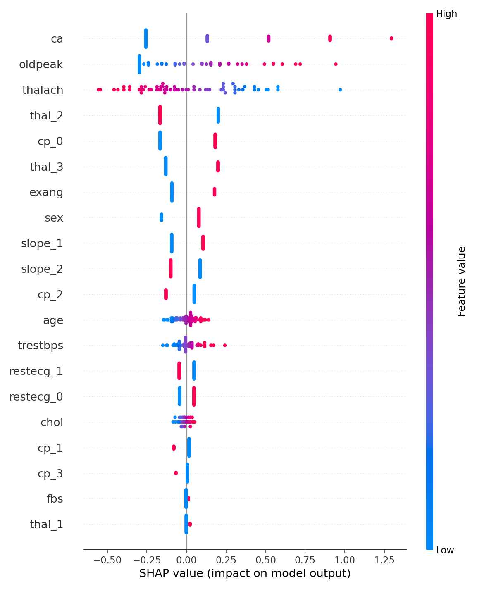

**Comment lire ce graphique.** Chaque point est un patient. Sa position horizontale est la contribution de la variable à sa prédiction : à droite, elle pousse vers « malade », à gauche vers « sain ». La couleur indique la valeur de la variable (rouge : élevée ou présente, bleu : basse ou absente). Exemple : pour « Major vessels colored », les points rouges (3 vaisseaux colorés) sont tout à droite, donc plus il y a de vaisseaux colorés, plus le modèle augmente la probabilité estimée.

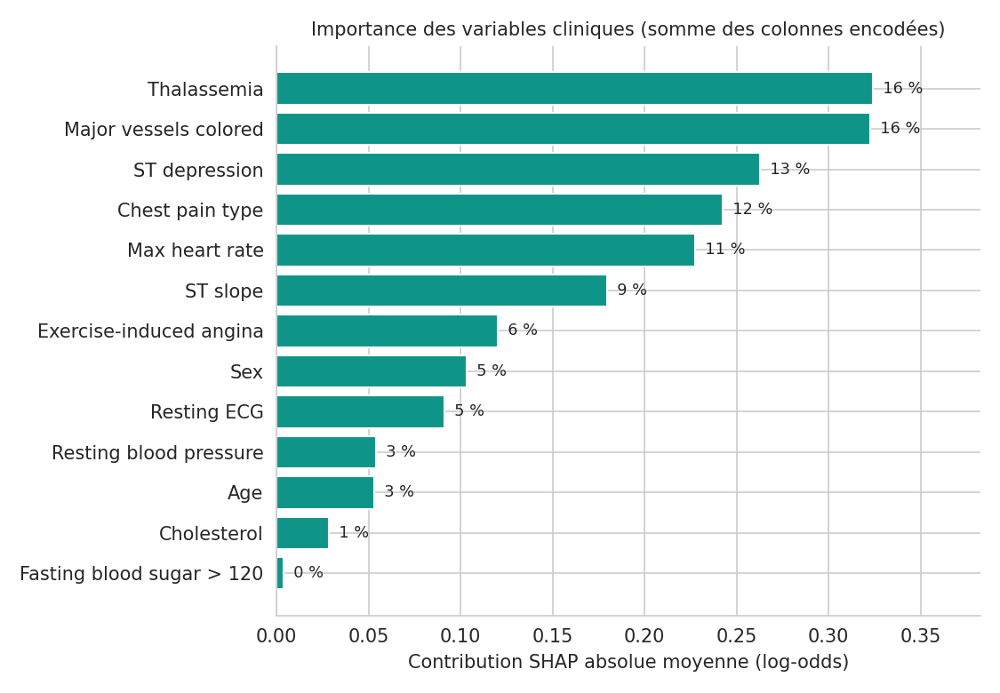

**Comment lire ce graphique.** La longueur d'une barre est la contribution SHAP absolue moyenne de la variable (toutes colonnes encodées additionnées) ; le pourcentage est sa part du total. Une barre longue signifie que le modèle s'appuie beaucoup sur cette variable, **dans un sens ou dans l'autre**.

| Variable | Part | Comment le modèle l'utilise |
|---|---|---|
| Thalassemia | 16 % | « reversible defect » augmente la probabilité (+0.20 en moyenne), « normal » la réduit (−0.17) |
| Major vessels colored | 16 % | contribution moyenne −0.26 pour les valeurs basses, +0.41 pour les hautes |
| ST depression | 13 % | −0.30 pour les valeurs basses, +0.43 pour les hautes |
| Chest pain type | 12 % | « asymptomatic » augmente (+0.18), « non-anginal pain » réduit (−0.13) |
| Max heart rate | 11 % | +0.39 pour les valeurs basses, −0.32 pour les hautes : une fréquence max élevée réduit la probabilité |
| ST slope | 9 % | « flat » augmente (+0.10), « upsloping » réduit (−0.10) |

Ces six variables représentent 77 % de l'importance totale. Les directions sont cohérentes avec les associations cliniques habituelles : c'est un contrôle de bon sens (avant la correction de `target`, elles étaient à l'envers), pas une preuve de causalité.

### Vue individuelle : expliquer un patient

Deux patients du jeu de test (jamais vus à l'entraînement par le modèle déployé) :

| Patient à risque élevé (n° 191) | Patient à faible risque (n° 162) |
|---|---|
| 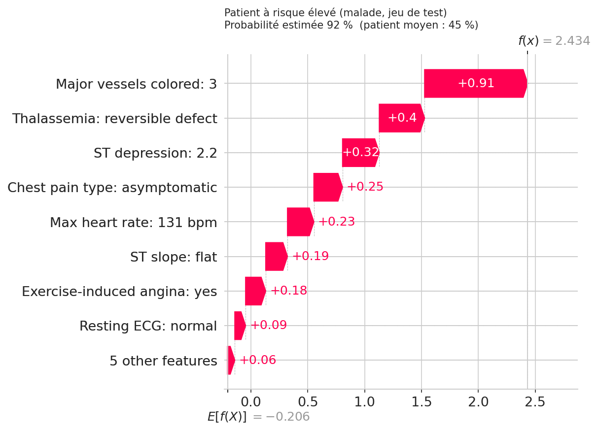 | 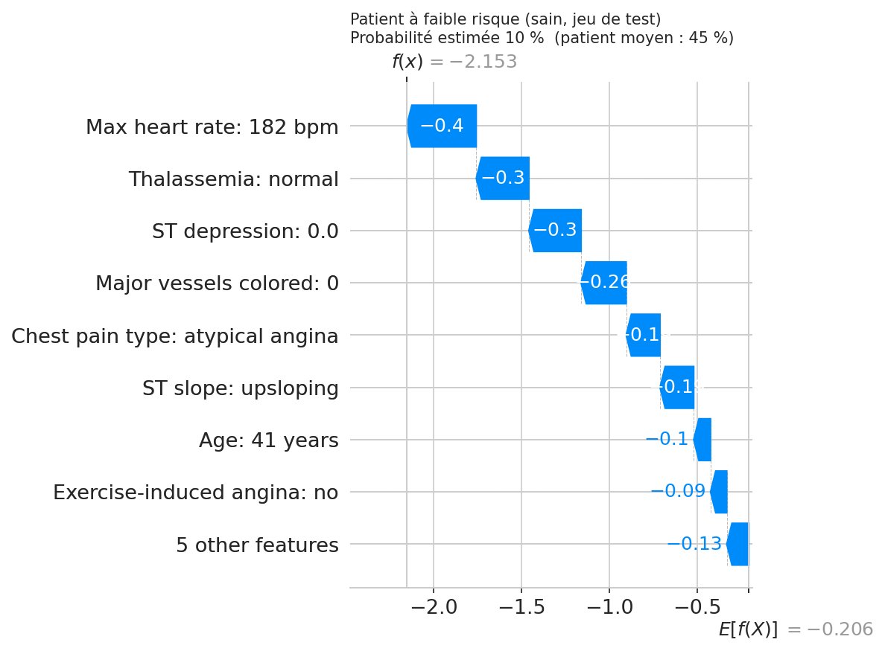 |

**Comment lire ces graphiques.** On part en bas de la valeur de base (le patient moyen : −0.21 en log-odds, soit 45 %). Chaque barre ajoute la contribution d'une variable, avec la valeur du patient à gauche : rouge vers « malade », bleu vers « sain ». En haut, `f(x)` est la sortie du modèle pour ce patient (2.43 en log-odds, soit 92 %, pour le premier). La longueur d'une barre est en log-odds, pas en points de pourcentage.

**Interprétation du patient n° 191 (probabilité estimée 92 %).** Ce qui pèse le plus : 3 vaisseaux colorés (+0.91), thalassémie à défaut réversible (+0.40), dépression ST de 2.2 (+0.32) et douleur thoracique asymptomatique (+0.25). Aucune variable ne tire notablement vers « sain ».

**Interprétation du patient n° 162 (probabilité estimée 10 %).** Ce qui pèse le plus vers « sain » : fréquence cardiaque max de 182 bpm (−0.40), thalassémie normale (−0.30), dépression ST nulle (−0.30) et aucun vaisseau coloré (−0.26). Seul le sexe masculin tire légèrement vers « malade » (+0.08).

Ces textes sont générés automatiquement à partir des valeurs SHAP (`src/shap_utils.py::describe_patient`) ; le dashboard (version JavaScript de la même règle) et l'app Streamlit produisent un texte du même type pour n'importe quel patient saisi, à partir des mêmes contributions (l'équivalence des chiffres entre le dashboard et l'API est testée). Le rapport complet est dans `reports/shap_interpretation.md`.

### SHAP sur les erreurs

L'analyse des faux positifs et des faux négatifs avec SHAP est dans la section « Analyse des erreurs » ci-dessus (`reports/shap_errors.png` et les deux waterfalls individuels).

### Les trois modèles expliquent-ils de la même façon ?

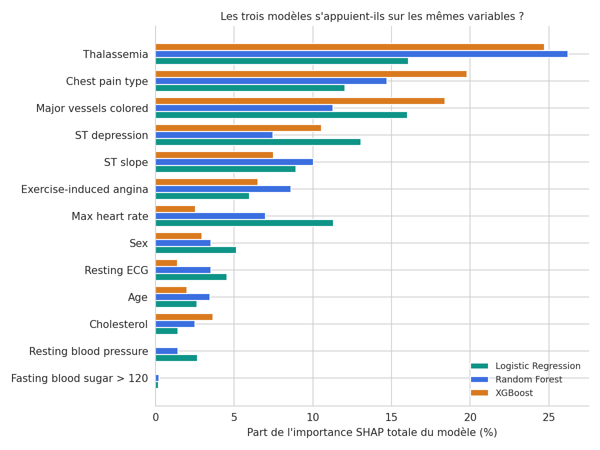

**Comment lire ce graphique.** Pour chaque modèle (hyperparamètres réglés sur le jeu d'entraînement), la barre donne la part de l'importance SHAP totale portée par une variable. On compare des parts relatives, car les valeurs SHAP de la forêt aléatoire sont en probabilité et celles des deux autres modèles en log-odds.

Les trois modèles se rejoignent sur l'essentiel : la corrélation de rang de Spearman entre leurs importances est de 0,91 (régression logistique / forêt), 0,83 (régression logistique / XGBoost) et 0,92 (forêt / XGBoost), et trois variables sont dans le top 5 de chacun (vaisseaux colorés, type de douleur thoracique, thalassémie). Ils diffèrent sur les proportions : la thalassémie pèse 16 % pour la régression logistique contre 26 % et 25 % pour les deux modèles à arbres, tandis que la fréquence cardiaque max pèse 11 % contre 7 % et 3 %. Comme les trois modèles ont des performances statistiquement équivalentes, cet accord renforce la confiance dans l'explication, sans l'établir comme une vérité médicale.

## Trois interfaces pour le même modèle

| Interface | Ce qu'elle montre | Lancer |
|---|---|---|
| `web/index.html` | Dashboard HTML/CSS/JS. Appelle l'API si elle tourne (badge « Live API »), sinon calcule en local avec les coefficients du modèle | double-clic sur le fichier |
| `app.py` | Prototype Streamlit tout-en-un | `streamlit run app.py` |
| `api/main.py` | Backend FastAPI (`/predict`, `/explain`, `/health`), doc Swagger auto-générée | `uvicorn api.main:app --reload` puis `http://127.0.0.1:8000/docs` |

Le dashboard et l'app Streamlit affichent, pour n'importe quel patient saisi, la prédiction, les deux probabilités, un graphique SHAP dynamique (cascade du patient moyen à la prédiction, avec la probabilité cumulée), un texte d'interprétation, et le rappel que SHAP n'est pas causal et que l'outil n'est pas un diagnostic. L'endpoint `/explain` de l'API renvoie les contributions SHAP, la valeur de base, son unité et la même note.

Les calculs locaux du dashboard et de l'API ont été comparés sur 60 patients : écart maximal 5·10⁻⁵ sur les probabilités et sur les contributions SHAP. Un test automatique (`tests/test_dashboard_sync.py`) garde cette équivalence : si le modèle est réentraîné sans relancer `python src/export_dashboard.py`, la CI échoue au lieu de laisser le dashboard afficher des chiffres périmés.

```bash
curl -X POST http://127.0.0.1:8000/predict \
  -H "Content-Type: application/json" \
  -d '{"age":58,"sex":1,"cp":3,"trestbps":130,"chol":250,"fbs":0,"restecg":0,"thalach":148,"exang":0,"oldpeak":1.4,"slope":1,"ca":0,"thal":2}'
```

## Structure du projet

```
heart-disease-shap/
├── data/heart.csv
├── notebooks/heart_disease_analysis.ipynb   # EDA, aperçu, résultats de CV, analyse des erreurs, SHAP
├── src/
│   ├── preprocessing.py     # chargement, étiquette corrigée, one-hot, split, standardisation
│   ├── model_config.py      # les 3 modèles et leurs recherches d'hyperparamètres
│   ├── encoding_ablation.py # teste les choix d'encodage (ca, nominales, valeurs aberrantes)
│   ├── evaluate.py          # validation croisée imbriquée, métriques, analyse des erreurs
│   ├── train.py             # modèle final (tuning par CV) -> models/best_model.joblib
│   ├── shap_utils.py        # outils SHAP partagés : agrégation par variable, texte d'interprétation
│   ├── explain.py           # SHAP global et individuel, textes, comparaison des modèles
│   └── export_dashboard.py  # synchronise web/index.html avec le modèle et les résultats
├── api/                     # FastAPI : main.py, schemas.py
├── web/index.html           # dashboard
├── app.py                   # Streamlit
├── tests/                   # 29 tests : preprocessing, anti-fuite, métriques, sélection, SHAP, API, synchro dashboard
├── models/                  # best_model.joblib, results.json, graphiques SHAP
├── reports/                 # résultats de CV, figures, patients mal classés
└── .github/workflows/ci.yml # tests à chaque push
```

## Reproduire

```bash
pip install -r requirements.txt
python src/evaluate.py     # ≈ 100 s : CV imbriquée, choix du modèle, analyse des erreurs
python src/encoding_ablation.py   # ablation des choix d'encodage
python src/train.py        # modèle final -> models/best_model.joblib
python src/explain.py      # SHAP : graphiques, interprétation, comparaison des modèles (~1 min)
python src/export_dashboard.py   # met à jour web/index.html
pytest tests/ -v           # 29 tests
```

## Limites

- Un seul centre (Cleveland) et 303 patients : pas de validation externe, résultats à ne pas extrapoler.
- Forte variance entre plis (écart-type du F1 ≈ 0,08) : les différences entre modèles ne sont pas significatives.
- Le modèle est choisi (règle de l'erreur standard) avec les mêmes plis externes que ceux qui rapportent sa performance : un léger optimisme est possible. L'effet est faible puisque les trois modèles sont indiscernables, mais une estimation sans biais demanderait un jeu de test jamais utilisé pour choisir.
- Rappel de ≈ 78 % au seuil 0,5. Pour un usage de dépistage il faudrait régler le seuil, calibrer les probabilités et valider sur d'autres cohortes.
- Étiquette `target` du CSV inversée (corrigée, voir plus haut) et quelques valeurs hors documentation.
- Les noms des catégories de `cp`, `slope` et `restecg` sont déduits : le dictionnaire de données qui circule avec ce CSV est inversé pour `cp` et `slope`, et la correspondance de `restecg` est la moins sûre. Les explications SHAP sont cohérentes avec la clinique, ce qui conforte ce choix sans le prouver.
- SHAP décrit un modèle, pas la maladie : les explications dépendent du modèle (voir la comparaison ci-dessus) et ne disent rien de la causalité. Les variables corrélées entre elles (par exemple dépression ST et pente ST, corrélées à −0,58) se partagent le crédit de façon arbitraire.

## Pistes d'amélioration

- Validation externe sur les autres cohortes UCI (Hongrie, Suisse, Long Beach)
- Réglage du seuil de décision et calibration des probabilités
- Intervalles de confiance par bootstrap et validation croisée répétée
- Déploiement public de l'API et du dashboard

Dataset : [UCI Machine Learning Repository, Heart Disease](https://archive.ics.uci.edu/dataset/45/heart-disease). Projet à but pédagogique.
